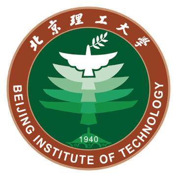
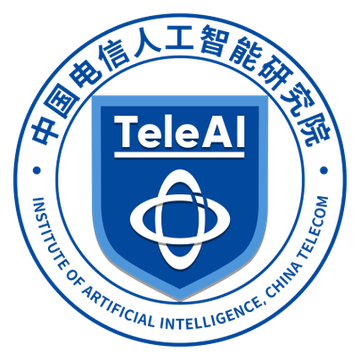
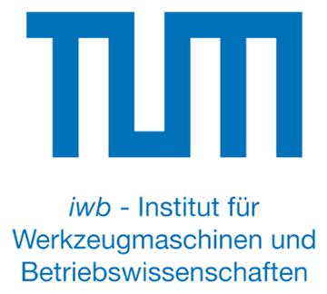



<section id="about" class="home-section" markdown="1">

I am a Research Engineer in the Humanoid Robot Group at the AI Institute of Chinatelecom (TeleAI) in Shanghai. My research focuses on robot learning and task and motion planning, with current work on simulation foundations for robot manipulation.

At TeleAI, I lead the simulation team developing scene, articulated-object, task, and demonstration generation for manipulation data production and sim-to-real policy transfer. My experience also includes agentic vision-language-action model deployment, robot control systems, LLM-based behavior tree generation, robot assembly, and robot milling.

</section>

<section class="home-section home-section--education" markdown="1">

<h2 id="education">Education</h2>

<h3>M.Sc. in Mechanical Engineering</h3>

Technical University of Munich, Munich, Germany 04.2021 - 10.2024

Fields: robot learning and task and motion planning

<h3>B.Sc. in Industrial Engineering</h3>

Beijing Institute of Technology, Beijing, China 09.2016 - 08.2020

Field: production planning and optimization

</section>

<section id="work-gallery" class="home-section home-section--work-gallery" markdown="1">

<h2>Work Gallery</h2>


<article class="work-gallery__item work-gallery__item--centered">
  <video autoplay muted loop playsinline controls preload="metadata" aria-label="{{ item.title }}">
    <source src="{{ item.video | relative_url }}" type="video/mp4">
    Your browser does not support HTML5 video.
  </video>
  

    {{ item.project }}
    <h3>{{ item.title }}</h3>
    
{{ item.description }}

    <a href="{{ item.url }}" target="_blank" rel="noopener">Project</a>
  

</article>


</section>

<section class="home-section" markdown="1">

<h2 id="projects">Projects</h2>



  


</section>

<section class="home-section" markdown="1">

<h2 id="publications">Publications</h2>




  


</section>

<section class="home-section home-section--experience" markdown="1">

<h2 id="experience">Experience</h2>

<h3>Research Engineer, Humanoid Robot Group</h3>

AI Institute of Chinatelecom (TeleAI), Shanghai 12.2024 - Present

<h3>Research Intern, Embodied AI Group</h3>

MEGVII Research (MEGVII Technology), Beijing 07.2024 - 11.2024

<h3>Research Intern &amp; Thesis Student, Collective Learning Group</h3>

Munich Institute of Robotics and Machine Intelligence (MIRMI), Munich 10.2022 - 06.2024

<h3>Thesis Student, Robotic Processing Group</h3>

Institute for Machine Tools and Industrial Management (IWB), Munich 06.2022 - 10.2022

<h3>Design and Manufacturing Engineer, Technical Department</h3>

EDDIE Precision Machinery Co, ltd, Yantai 10.2020 - 04.2021

</section>
